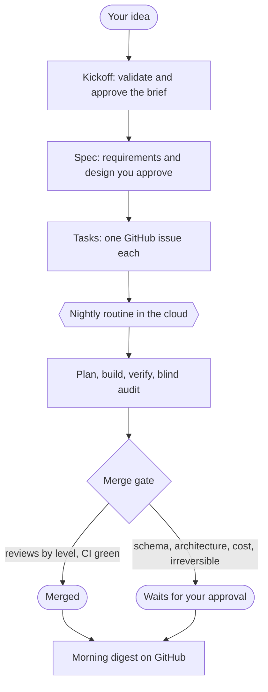

<p align="center">
  
</p>

<p align="center">
  <a href="CHANGELOG.md"></a>
  <a href="LICENSE"></a>
  
  
  
  
</p>

<p align="center">
  <b>The harness I use to build software with AI agents.</b><br>
  Agents plan, build, review and merge code at night, in the cloud. I get pulled in for design
  decisions, anything that costs money, and changes that are hard to undo.
</p>

<p align="center">
  <a href="#quick-start">Quick start</a> ·
  <a href="#how-a-day-looks">How a day looks</a> ·
  <a href="#what-you-need">What you need</a> ·
  <a href="#review-levels">Review levels</a> ·
  <a href="docs/GUIA.md">Guía en español</a>
</p>

---

> "Everyone who hears these words of mine and does them will be like a wise man who built his
> house on the rock." (Matthew 7:24)

## Why I built it

My setup with AI coding agents used to look like this. I wrote what I wanted, the agent wrote the
code, the same agent told me the code was fine, and I approved it. Then the next change, and the
next one. Most of my time went to reading small diffs and typing ok, ok, ok.

Two things bothered me. The agent was reviewing its own work, and of course it liked it. And I
could not leave it running at night, because nothing stopped it from adding a paid API, touching
production or merging something broken.

So I started from [trail-blazer-flow](https://github.com/msummer/trail-blazer-flow), an open source
harness by Mark Summer that already separated the planner, the implementer and the verifier, and
adapted it to how I work: mostly in the cloud, mostly unattended, with one hard rule about money.
Any amount that is a cost comes to me first.

## What it does

Rockbuilt is a set of skills, agents, a small Node CLI (`rb`) and a guard hook that get installed
inside each project repository. I use it with Claude Code; it also runs in Cursor, and Codex is
experimental.

| Who | Does | Cannot |
|---|---|---|
| Planner | Reads the live code and writes the plan for one task, with its review level, what needs my approval and any cost | Write code |
| Implementer | Writes the code and the tests | Touch git, GitHub or secrets |
| Verifier | Checks the work against the plan, and plants small bugs on purpose to see if the tests catch them | Fix anything |
| Blind auditor | Tests the running software against the acceptance criteria | See the plan, the review or how it was built |
| Merge gate | Decides what merges on its own. It is code, so a model cannot talk its way past it | Merge a plan I did not approve |

It covers the whole path: the idea and whether it is worth building, the spec, the tasks as GitHub
issues, the code, unit and end-to-end tests with Playwright, evals for AI features, a security
review and the merge. It works for new projects and for repositories that already have code.

## How a day looks



In the morning I get a notification. The `Rockbuilt control` issue on GitHub has the digest of the
night: what merged (each with a one-line command to revert it), what waits for me, and the
minutes of each task split by phase (plan, build, verify, audit, security, kickbacks, CI), so I
can see where the night went. Progress notes and lessons travel in one bookkeeping PR per day,
pushed after every task (so a session that dies loses nothing), and the next run merges it on its
own.

If I work on a task in a session while the routine runs, the session claims it (`rb claim`) and
the routine leaves it alone while it shows activity in the last 3 hours. Every reviewer's verdict
goes on the task issue, so the numbers are the same whether the work ran at night or with me.

During the day I answer what it asked, with a comment or the `rb:approved` label, usually from the
phone. Small work I either ask for in a session ("add a total-only option to the CLI"), or add as a
GitHub issue labelled `rb:task` or `rb:bug` for the night. A new feature is a short session where I
approve the requirements and the design. That is most of my part.

A small change asked in a session goes through `/rb-quick` and skips the planner and the
implementer. The session writes it, the tests and lint run after every change, and one verifier
and one blind auditor review the whole batch once before the session tells me it is done. A batch
that grows past 400 lines or 12 files, or reaches level 3 or anything I must approve, goes back to
the full path. A docs-only change is level 1: CI checks it and nothing else runs. `/rb-quick #12 #15` builds
existing small issues as one batch, and the nightly cycle batches docs-only issues on its own.

At night the routine picks up the backlog and my answers, builds, reviews and merges. The first
real night it took a bug from an issue, reproduced it with a test, fixed it, had it verified and
audited, and merged it in 14 minutes. The verifier sent it back once on the way, because the
tests did not catch two of the bugs it planted.

When two or more PRs are ready, they go through a merge queue: the harness stacks them on `main`
one after another and pushes each step as its own branch, so CI tests every step at the same time,
and then each PR merges in order without being updated. The gate only accepts it when GitHub's own
test merge of that PR has exactly the tree CI tested, and checks the landed tree again after the
merge. Before 0.9.0 every merge left the others behind and each paid another full CI run, one
after the other. Outside the
queue, merges go one at a time, so after each one the next PR can be behind `main`. If all `main` gained
is bookkeeping (task status, progress notes, lessons), the PR merges as it is. If `main` gained
code, the PR is updated and CI runs again; when the update changed nothing in the task's own files,
the merge gate confirms it itself and keeps every reviewer's verdict, with no agent and nothing to
edit, instead of repeating the review. If a fix after a review touched only test files, the
auditor's verdict stands, because the app it judged did not change. Anything else runs the full
review again, and a fix after the PR exists goes on top as one more commit (the merge squashes),
never a new PR. The auditor's verdict stays on the task issue, so a re-audit in another session
checks only what failed or could have changed. Locally the agents run only the end-to-end tests the task touched; the full suite
runs in CI.

The digest also shows quality for the last 7 days: kickbacks by reviewer (an auditor kickback is
something the verifier let through), reverts, and bugs that came from merged PRs. That is how I
check that the speed is not costing quality, instead of taking the harness's word for it. And when
a feature is finished, `/rb-verify` ends with a goal check: an auditor who never saw the tasks uses
the feature as the user in the brief would, and says whether it delivers what the goal promised.

My computer stays out of it unless a step really needs it, like a local browser or credentials
that only live on my machine. Those come labelled `rb:needs-local` with the exact commands. Before
escalating, a cloud run tries the cloud's own Chromium and installs a tool the project names when
pip or npm has it, since each escalation costs me a day.

## What you need

| Requirement | Why |
|---|---|
| A Claude plan with Claude Code (Pro or Max) | Sessions and nightly routines run on your subscription |
| A GitHub account and one repository per project | Issues, PRs, CI and the run state live there |
| The Claude GitHub app with access to that repository | Cloud sessions can only clone and push repos you grant |
| Node.js 20 or newer | The `rb` CLI and the guard hook are plain Node, no other dependencies |
| For local work only: git and the GitHub CLI (`gh auth login`) | The cloud already has both |

Branch protection: on a public repo it is free and kickoff or adopt turns it on (`rb protect`). On
a private repo it needs GitHub Pro (USD 4 per month); Rockbuilt never buys it for you. Without
it, `rb merge-gate` enforces the same rules, but a merge you make in the GitHub UI skips the gate,
so every digest reminds you until it is on or you write `Branch protection: declined` in AGENTS.md.

## Quick start

### Every new project (in the cloud)

Do these once per project, in this order:

- [ ] **Create the repository on GitHub**, private, **with a README** (so the `main` branch exists).
      Cloud sessions cannot create repositories.
- [ ] **Give the Claude GitHub app access to it**: GitHub, Settings, Applications, Claude,
      Configure, Repository access, add the repo, Save.
- [ ] **Turn on branch cleanup**: in the repo, Settings, General, check
      **Automatically delete head branches**. Cloud sessions cannot delete branches, so without
      this every merged PR leaves one behind.
- [ ] **Open a session** at [claude.ai/code](https://claude.ai/code) with two repositories: the new
      one and `ragarciaga/rockbuilt` (where the harness comes from).
- [ ] **Say what you want to build**: "let's start a project: ..." (or `/rb-kickoff`). Answer the
      interview and approve the brief. Rockbuilt installs itself in the repo, writes `AGENTS.md`,
      the brief and the architecture decisions, creates the labels and the control issue, and
      opens the kickoff PR. You merge that one.
- [ ] **Create the nightly routine**: a scheduled routine on the repo with the prompt
      `Run /rb-cycle. [rockbuilt:unattended]`, notifications on. Step by step in [docs/CLOUD.md](docs/CLOUD.md).
- [ ] **Specify the first feature** in a short session: "new feature: ..." (or `/rb-spec`).
      From then on the routine builds every night.

### An existing project

Same checklist, but in the session say "adopt this repo" (or `/rb-adopt`). Rockbuilt maps the
code, writes `AGENTS.md` from what it finds, records a baseline of the tests (known failures do
not block, new ones do) and asks what you want to do first.

### On your computer instead

```text
/plugin marketplace add ragarciaga/rockbuilt
/plugin install rockbuilt@rockbuilt
/rockbuilt:install
```

Open a new session afterwards so the commands load, then continue with "let's start a project" or
"adopt this repo". Locally, Rockbuilt can create the GitHub repository for you with `gh`.

### Updating a project

In a session on the project, say "update rockbuilt" (or run `/rockbuilt:install` again). It
copies the new version into the repo in a PR, adds the routing line to CLAUDE.md when it is
missing (the only project file it touches, one line), and offers `rb protect` when branch
protection is off and free. Read the [CHANGELOG](CHANGELOG.md): some versions
ask for one manual step, like the routine prompt below.

Every routine prompt ends with `[rockbuilt:unattended]` (since 0.4.0). That tag tells the hours
report the message was not yours. Routines created before need it added by hand.

### Settings in AGENTS.md

Header lines at the top of the project's `AGENTS.md`. All have defaults.

| Line | Default | What it does |
|---|---|---|
| `Autonomy: auto` | `auto` | `supervised` makes every PR wait for you |
| `Parallel: auto` / `Max parallel: 3` | `auto`, 3 | Tasks with no shared files are built at the same time |
| `Max tasks per run: 6` | 6 | How much one nightly run takes on |
| `E2E shards: 3` | 1 | Splits the Playwright suite into that many CI jobs, each with its own 30 minute limit. Use it when the suite passes about 15 minutes. On a private repo each shard spends extra Actions minutes |
| `Hours: local` | `github` (`local` on public repos) | Where your time marks go. Use `local` in a client's repo: the hours issue shows timestamps and branch names to anyone who can see the repo. `off` disables it |
| `Branch protection: declined (<date>, <reason>)` | none | You chose not to pay for branch protection on a private repo. The digest stops reminding you |
| `Profile: full` | `full` | `minimal` merges levels 1 and 2 on green CI and reviews only level 3 (verifier and security), for a tool only you use. `none` means no harness at all, for something that never reaches real users. Kickoff and adopt recommend one |
| `Launch: 2026-12-10` | `not set` | The day real users arrive. Until an attack report exists, status and the digest remind you to run `/rb-attack` |
| `Feature review: off` | `off` | `on` sends the level 2 tasks of a spec to `rb/feature-<NN-slug>` with the verifier, and runs the blind auditor and the security review once on the whole feature, in its PR to `main` |

Two optional sections take one command per line. `## Deploy check` runs after every merge when the
host deploys `main` (Railway, Vercel, Fly): it exits 0 once the merged commit is live, and a
failure opens an `rb:bug` issue. `## Seed` loads committed fixtures and a test user, so the blind
auditor can check the app in a browser. Write both as npm scripts: unattended runs only run
commands the permission list allows.

### Talking to it

You do not need the command names. These work in any session:

| You say | It runs |
|---|---|
| "let's start a project", "I want to build ..." | `/rb-kickoff` |
| "adopt this repo" | `/rb-adopt` |
| "new feature: ..." | `/rb-spec`, then `/rb-tasks` on its own |
| "build", "build issue 12", "build without merging" | `/rb-build`, right now, no routine needed |
| "explore for an hour whether ...", "spike: ..." | `/rb-spec` in exploration mode: a time box on `rb/explore-*`, never merged; the conclusion feeds the spec |
| "attack the app before launch", "hackea la app antes de salir" | `/rb-attack` (once, on the live system, in a scope you approve; critical findings block the launch) |
| "fix this bug: ..." | `/rb-fix` (failing test first) |
| "add X", "change Y", any small change | `/rb-quick` (you implement nothing; it batches the changes and reviews the batch once before saying done) |
| "verify the feature" | `/rb-verify` (E2E, security, evals) |
| "merge PR 12", "revert PR 12" | `/rb-merge` |
| "where are we", "what happened last night" | `/rb-status` (it also says when progress.md missed merges, and offers to refresh it) |
| "hours report", "how many hours this month" | `/rb-status` (your hours per project, feature and task) |
| "log 45 minutes of a client call on feature 02" | `/rb-status` (a manual time entry) |
| "retro" | `/rb-retro` (includes tests that failed once and passed on a re-run, `rb flaky list`) |

## Review levels

Every change gets a level, computed by `rb risk` from the real diff. The planner declares one too
and the higher wins: a model can raise a level, never lower it. The level decides who reviews; it
never decides whether I am asked.

| Level | Typical change | Reviews | Merge |
|---|---|---|---|
| **1** | Docs, styles, copy, tests that only add | None, CI only | Automatic |
| **2** | Product code | Verifier; the blind auditor when something I see changes, on every bug fix and quick batch, and on one PR in five by sampling | Automatic |
| **3** | `Sensitive paths`, auth, payments, personal data, deletion, schema, CI and deploy, harness files, large diffs | Verifier, blind auditor, security reviewer | Automatic |

I am asked only for a closed list: schema and migrations, architecture (an ADR, a new spec, a
design decision), the auth model, a cost outside `Paid services` or over its cap, and anything
irreversible. A new runtime dependency is checked by code (license, deprecation, maintenance) and
reaches me only if it fails. Everything else takes a safe default and shows up in the report. I
approve the plan by writing "aprobado" on its issue; then the merge happens on its own when the
reviews and CI pass. The run never stops to ask: it sets the item aside, keeps working, and sends
me one message at the end (`rb state`).

To hand approvals over for a while I say it in a session: "delego todo hasta el viernes", "full
auto del milestone MVP". `/rb-delegate` records my words on the control issue, for 14 days by
default, without costs or irreversible items unless I name them; a "full auto" covers only that
run. Every merge it covers says "merged by delegation", and `rb delegate revoke` ends it.

Two settings change this table (see Settings): `Profile: minimal` drops the reviews of levels 1
and 2, and `Feature review: on` moves the blind auditor of level 2 to one review of the whole
feature. Work measured by a score (a prompt, a threshold) runs in calibration mode: each iteration
is kept only if the eval improves, within a cost cap, and the reviews run once on what stayed.

Before a plan reaches me (or any plan that touches personal data), the security reviewer reads it
and checks every decision in it against the requirements, so a wrong call shows up in two minutes
instead of after the code is written.
`Autonomy: supervised` in `AGENTS.md` makes every PR wait for you.

**Stop everything:** add the `rb:stop` label to any open issue. **Hold one PR:** add `rb:hold`.
**Undo a merge:** every merge comment carries `node tools/rockbuilt/rb.mjs revert <pr>`, which
opens a revert PR for you to merge.

## Safety

From strongest to weakest:

1. **GitHub side.** `rockbuilt-ci` (verification, end-to-end tests when possible, gitleaks secret
   scan) and `rb merge-gate`, the only merge path. The gate checks: level labels against the live
   diff (with the rules read from `AGENTS.md` at the PR's base), the reviews each level needs, my
   approval or a delegation when the plan needs one, reviewer verdicts on the exact head commit, a green CI run from GitHub Actions (and the
   `rockbuilt-e2e` check when the project has end-to-end tests), the PR is up to date with
   `main`, the stop switch is off, and the run holds the lock. After an update with `main`, the
   auditor's verdict on the previous commit only counts if the gate itself confirms, through
   GitHub, that the task's diff did not change; the verifier saying so is not enough.
2. **Permissions.** Narrow allow rules in `.claude/settings.json`. No reading `.env` files, no
   force pushes, no `reset --hard`, no `rm -rf`.
3. **Guard hook.** One Node script that every tool call goes through. It blocks pushes to `main`
   (also through wildcard refspecs or push config), pushes of commits with secret-shaped literals,
   kill by process name, `.env` reads through any tool, deploy and cloud CLIs (also through `npx`, package scripts and
   git aliases), git and GitHub access for the agents that write code, and edits to the harness
   itself. Read-only agents get an allowlist.
4. **Agent instructions.**

The guard catches mistakes, and a determined agent could still find a way around it, so the
merge gate and CI are what I really trust. One limit I have not solved: in the cloud the harness uses my own GitHub token, so in theory
it could imitate my approval. Every comment it writes is marked to make that harder, and a
separate bot identity is on the [roadmap](docs/roadmap.md).

## What gets installed in a project

<details>
<summary>Files and folders</summary>

| Path | What |
|---|---|
| `AGENTS.md` | The project contract: goal, stack, conventions, how to verify, autonomy settings |
| `CLAUDE.md` | `@AGENTS.md` plus notes for Claude Code |
| `tools/rockbuilt/` | The `rb` CLI and the guard hook, with a `VERSION` file and the `AGENTS.template.md` an update copies new contract text from |
| `.claude/skills/rb-*`, `.claude/agents/rb-*` | Skills and agents (Claude Code and Cursor read this path) |
| `.claude/settings.json` | Permissions, the guard hook and the two hooks that record your hours |
| `.github/workflows/rockbuilt-ci.yml` | The CI the merge gate requires |
| `docs/specs/`, `docs/adr/`, `docs/progress.md`, `.claude/LESSONS.md` | Specs, decisions, progress and lessons |
| `docs/research/`, `docs/security/` | Exploration conclusions; `/rb-attack` reports and the read-only probes you approved |
| `.cursor/*` (`--tools cursor`), `.agents/skills`, `.codex/*` (`--tools codex`) | Adapters for other tools |

Cloud sessions do not load plugins, so the harness is copied ("vendored") into each repo. The
plugin is only the installer and updater: run `/rockbuilt:install` again to update.

</details>

<details>
<summary>Agents</summary>

| Agent | Model | Role |
|---|---|---|
| rb-scout | Sonnet | Read-only map of an existing repo or of the code a spec touches |
| rb-planner | Opus | Plan per task with verified facts, review level, approvals and costs, open questions |
| rb-task-reviewer | Sonnet | Judges one task: size, alignment, completeness, necessity |
| rb-implementer | Sonnet | Executes an approved plan; no git, no GitHub, no secrets |
| rb-verifier | Opus | Plan conformance, criteria by ID, test quality with a mutation probe |
| rb-auditor | Opus | Blind audit of observed behavior against the acceptance criteria |
| rb-security-reviewer | Opus | OWASP-oriented review, authorization on every data path, cost triggers |
| rb-e2e-writer | Sonnet | Explores the running app and writes Playwright specs |
| rb-healer | Sonnet | Runs the E2E suite and classifies each failure |

</details>

<details>
<summary>The rb CLI</summary>

Deterministic steps live in a small Node CLI: `node tools/rockbuilt/rb.mjs <command>` in a project.
Commands: `vendor`, `init`, `doctor`, `verify-cmds`, `e2e-plan`, `baseline`, `tasks`,
`parallel`, `worktree`, `timing`, `hours`, `risk`, `review-delta`, `bookkeeping`, `ci` (wait for
CI on a commit, read a failing job's log), `browser` (find a preinstalled Chromium), `queue`,
`quality`, `claim`, `sync`, `gh`, `merge-gate`, `revert`, `control`, `lock`, `stop`, `escalate`,
`digest`, `flaky`, `protect`, `labels`. Every command accepts
`--json`; `help` lists the flags.

`rb doctor` checks the whole setup and says what to fix: the contract, CI, permissions, labels,
the control issue, branch cleanup and protection, deploy settings and the deploy check, whether
docs/progress.md missed merges, and whether CLAUDE.md sends chat requests through a skill.

</details>

## What it costs

A night with one or two tasks used roughly 1 to 3 dollars of plan usage in my tests, measured at
API prices. It runs on my Claude subscription, so nothing extra is billed. GitHub Actions on a
private repository has a free monthly quota of minutes, and CI only runs when a PR opens or gets a
new push.

Branch protection on a private repository needs GitHub Pro, 4 dollars a month. I have not bought
it; the merge gate does the same job meanwhile. Any other cost, like a paid API or hosting, comes
to me first.

## Your hours

I work on several projects at once, so a session clock lies: two hours jumping between three
projects would count as six. Rockbuilt counts attention instead. Each message I write in a
project session and each comment I leave on its GitHub issues and PRs is a mark with a time
(only the time and the branch, never the text). Marks closer than 10 minutes form a block, and
when two projects overlap in time the minutes are split between them. A call or anything that
leaves no mark I add by hand ("log 45 minutes of a client call").

"Hours report" gives a table per project, feature and task with my hours, the agents' minutes and
two baselines: my own estimate of the feature without agents (asked when I approve the
requirements) and the planner's estimate per task. It also gives a CSV; the hourly rate goes in
my spreadsheet, never in the repo. It is an estimate, so before quoting with it I compare it with
a week of hours kept by hand. Details in [docs/GUIA.md](docs/GUIA.md).

## Status

Version 1.5.1. 1.5 adds `/rb-attack`: before real users arrive, it attacks the live system once,
inside a scope I approve, and every critical finding blocks the launch until fixed. 1.4 adds modes for complex work: time-boxed explorations that never merge,
calibration loops gated by the eval, one audit per feature, and a review profile per project.
1.3 checks safety steps before the reviewers, keeps reviewers from seeing each
other's leftovers and moves agent reports to files. 1.2 makes each spec settle its decisions up front (a six-line inventory per
requirement, asked in one round with defaults). 1.1 stops the obvious questions, batches small issues in one PR and keeps the
time a PR waits for me apart from CI. 1.0 changed what asks me and who reviews what, after measuring 539 merged PRs of
five projects: the old rule put 52% to 87% of PRs in the tier that waits for me, and one project
reached about 21 interruptions a day. Before releasing it I asked two separate agents, with no
context on how it was built, to break the new merge gate. They found real holes (an "ok" that
approved a migration the plan never named, a second `Closes` riding on another issue's approval, a
spec branch that could carry code); every one is fixed with a test (DESIGN.md section 29).

Then I ran it against a private test repository with real GitHub and real CI, and later as a real
scheduled routine. CI passes on Windows, macOS and Linux; the macOS run is how I found that the
guard did nothing when the project path went through a symlink.

Now it runs every night on a real project. Its nights decide what changes: in 0.5.0 the
end-to-end suite stopped fitting in 30 minutes (now it runs in shards), five re-reviews in one
night found nothing and cost 15 to 25 minutes each (now a short check when the diff did not
change), and a few small bugs in labels and branch cleanup. In 0.6.0, from that same project's own
write-up, mostly time: local end-to-end runs only what the task touched, a fix that only changed
tests keeps the auditor's verdict, plans get a security read before anyone builds them, the
auditor has a time budget, and every phase is timed so the retro sees where the hours go. In
0.7.0, from the next run's list of where time went: a PR behind only on bookkeeping merges without
another CI round (about 45 minutes in one run), the identity check after an update is `rb`, not an
agent, `rb sync` stopped clearing the run's own claims, fixes after a PR go on top instead of a new
PR, bookkeeping is pushed after every task, the auditor's verdict survives the session, and a cloud
run tries its own browser and installable tools before asking for my machine.

0.8.0 is about quality, not time. The eval suite showed that a rule written only in a skill gets
skipped: tier C plans reached me without their security read. That step is now checked by `rb`,
and the same principle applies to anything an eval shows skipped. Speed also has a quality number
beside it now (`rb quality`, in the digest): kickbacks by reviewer, reverts, and bugs traced back
to merged PRs. Each finished feature gets one last check against the product goal, done blind as
its user, and tasks too big to review well fail `rb tasks`.

0.9.0 removes the serial bottleneck of the merge train with a merge queue (one CI run for several
PRs), and the eval suite now drives a full cycle against a GitHub simulator backed by a real git
repo, so the autonomous merge path is tested before a release instead of on a real project's night.

0.10.0 comes from a week of interactive sessions on that project, which follow the skills by hand
and skip any step nothing checks. So those steps are now commands that something checks: every
verdict is posted on the task issue and the merge gate refuses a PR without it (which also makes
`rb quality` complete for interactive work), a session claims its task with `rb claim` so the
nightly run leaves it alone, status lines are built by `rb gh pr-line` flags instead of typed,
`rb ci wait` and `rb ci logs` replace hand-written polling, and `rb browser` finds the cloud's
Chromium instead of a hard-coded path. It also fixes the false positives that sent PRs to me for
nothing (a URL inside a test, a base change only in progress notes), separates the repository
language from the chat language, and checks screen layouts on a phone size matrix.

0.11.0 comes from a feature of 24 small tasks on another project where the reviews cost more than
the code. The biggest waste was re-running the auditor and the security reviewer after every merge
from `main` that did not touch the task; now the merge gate checks that and keeps their verdicts.
The security review runs when the diff needs it (request input, process spawns, file writes,
secrets, auth, new hosts or dependencies), decided by `rb risk` instead of the planner's judgment.
Secret-shaped test fixtures are caught before the first push, and `rb tasks` asks to merge small
tasks of the same module. The blind audit still runs on every task: it found real defects in small
ones.
The retro of the next two features added the rest: bookkeeping PRs that merge without a manual
retarget, task ids with a run prefix that no longer block a merge, every safety step in a plan
tested by deleting it, timing that records itself when the session never calls `rb timing`, and
CI on the Node version the project pins in `.nvmrc`.

0.12.0 to 0.14.0 come from the retros of two more projects and from my own complaint: simple
changes took hours and too many tokens, because each one paid for a planner, an implementer and two
reviewers, about 300k to 450k tokens a task. Most of my work arrives as requests in a chat, and those
had no path at all, so 25 PRs across those projects went in with no review. `/rb-quick` gives them
one that runs the review once per batch. In its eval the verifier still sent the batch back for two
real defects.

0.13.0 closes the ways to opt out without noticing. A kickoff can no longer leave the harness for
later (one project ran a month in production that way), and branch protection is either on or
declined in writing, after two PRs with red CI were merged by hand on a repo where protection was
free. 0.14.0 looks after the merge: an optional deploy check confirms the merged commit is live,
the walking skeleton runs once in the real environment before features start, the design asks how
I really use each external account and what its limits are, and `rb doctor` notices when the
progress notes miss merges.

What stays manual for now: creating each repository, giving the Claude app access to it, approving
designs, anything that costs money and the plans on the closed list (schema, architecture, auth
model, cost, irreversible). I use Cursor little and I have not
tested Codex at all. The full history is in [CHANGELOG.md](CHANGELOG.md) and the evidence for each
decision in [DESIGN.md](DESIGN.md) (section 20).

## Documentation

| Document | For |
|---|---|
| [docs/GUIA.md](docs/GUIA.md) | User guide (Spanish) |
| [docs/CLOUD.md](docs/CLOUD.md) | Setting up the nightly routine, reading results, stopping and reverting (Spanish) |
| [DESIGN.md](DESIGN.md) | The contract every skill, agent and script follows, with the evidence behind each decision |
| [docs/MEJORAR.md](docs/MEJORAR.md) | How the harness itself is improved: evidence, evals, retro (Spanish) |
| [docs/roadmap.md](docs/roadmap.md) | What comes next and the signal for each item |

## Contributing

```text
npm test                              # guard hook, rb CLI and selfcheck
claude plugin validate . --strict
node evals/run.mjs --arms with        # headless evals of every skill
```

Changes start from evidence (a failing eval, a retro finding or a CI failure). The maintainer
rules are in [.claude/CLAUDE.md](.claude/CLAUDE.md).

## Credits

The planner, implementer and verifier mechanics are adapted from
[trail-blazer-flow](https://github.com/msummer/trail-blazer-flow) by Mark Summer (MIT). The rest is
my own work.

## License

[MIT](LICENSE) © 2026 Rafael Andrés García
