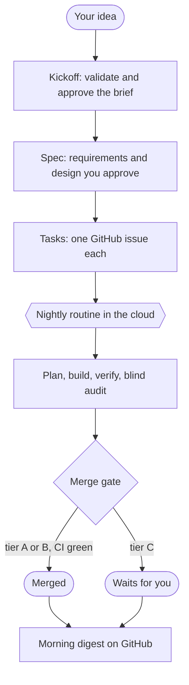

<p align="center">
  
</p>

<p align="center">
  <a href="CHANGELOG.md"></a>
  <a href="LICENSE"></a>
  
  
  
  
</p>

<p align="center">
  <b>The harness I use to build software with AI agents.</b><br>
  Agents plan, build, review and merge code at night, in the cloud. I get pulled in for design
  decisions, anything that costs money, and changes that are hard to undo.
</p>

<p align="center">
  <a href="#quick-start">Quick start</a> ·
  <a href="#how-a-day-looks">How a day looks</a> ·
  <a href="#what-you-need">What you need</a> ·
  <a href="#autonomy-tiers">Autonomy tiers</a> ·
  <a href="docs/GUIA.md">Guía en español</a>
</p>

---

> "Everyone who hears these words of mine and does them will be like a wise man who built his
> house on the rock." (Matthew 7:24)

## Why I built it

My setup with AI coding agents used to look like this. I wrote what I wanted, the agent wrote the
code, the same agent told me the code was fine, and I approved it. Then the next change, and the
next one. Most of my time went to reading small diffs and typing ok, ok, ok.

Two things bothered me. The agent was reviewing its own work, and of course it liked it. And I
could not leave it running at night, because nothing stopped it from adding a paid API, touching
production or merging something broken.

So I started from [trail-blazer-flow](https://github.com/msummer/trail-blazer-flow), an open source
harness by Mark Summer that already separated the planner, the implementer and the verifier, and
adapted it to how I work: mostly in the cloud, mostly unattended, with one hard rule about money.
Any amount that is a cost comes to me first.

## What it does

Rockbuilt is a set of skills, agents, a small Node CLI (`rb`) and a guard hook that get installed
inside each project repository. I use it with Claude Code; it also runs in Cursor, and Codex is
experimental.

| Who | Does | Cannot |
|---|---|---|
| Planner | Reads the live code and writes the plan for one task, with its risk tier and any cost | Write code |
| Implementer | Writes the code and the tests | Touch git, GitHub or secrets |
| Verifier | Checks the work against the plan, and plants small bugs on purpose to see if the tests catch them | Fix anything |
| Blind auditor | Tests the running software against the acceptance criteria | See the plan, the review or how it was built |
| Merge gate | Decides what merges on its own. It is code, so a model cannot talk its way past it | Merge tier C work |

It covers the whole path: the idea and whether it is worth building, the spec, the tasks as GitHub
issues, the code, unit and end-to-end tests with Playwright, evals for AI features, a security
review and the merge. It works for new projects and for repositories that already have code.

## How a day looks



In the morning I get a notification. The `Rockbuilt control` issue on GitHub has the digest of the
night: what merged (each with a one-line command to revert it), what waits for me, and how many
minutes each task took.

During the day I answer what it asked, with a comment or the `rb:approved` label, usually from the
phone. Small work I add as a GitHub issue labelled `rb:task` or `rb:bug`. A new feature is a short
session where I approve the requirements and the design. That is most of my part.

At night the routine picks up the backlog and my answers, builds, reviews and merges. The first
real night it took a bug from an issue, reproduced it with a test, fixed it, had it verified and
audited, and merged it in 14 minutes. The verifier sent it back once on the way, because the
tests did not catch two of the bugs it planted.

My computer stays out of it unless a step really needs it, like a local browser or credentials
that only live on my machine. Those come labelled `rb:needs-local` with the exact commands.

## What you need

| Requirement | Why |
|---|---|
| A Claude plan with Claude Code (Pro or Max) | Sessions and nightly routines run on your subscription |
| A GitHub account and one repository per project | Issues, PRs, CI and the run state live there |
| The Claude GitHub app with access to that repository | Cloud sessions can only clone and push repos you grant |
| Node.js 20 or newer | The `rb` CLI and the guard hook are plain Node, no other dependencies |
| For local work only: git and the GitHub CLI (`gh auth login`) | The cloud already has both |

Optional: GitHub Pro (USD 4 per month) enables branch protection on private repos. Rockbuilt never
buys it for you; without it, `rb merge-gate` enforces the same rules.

## Quick start

### Every new project (in the cloud)

Do these once per project, in this order:

- [ ] **Create the repository on GitHub**, private, **with a README** (so the `main` branch exists).
      Cloud sessions cannot create repositories.
- [ ] **Give the Claude GitHub app access to it**: GitHub, Settings, Applications, Claude,
      Configure, Repository access, add the repo, Save.
- [ ] **Turn on branch cleanup**: in the repo, Settings, General, check
      **Automatically delete head branches**. Cloud sessions cannot delete branches, so without
      this every merged PR leaves one behind.
- [ ] **Open a session** at [claude.ai/code](https://claude.ai/code) with two repositories: the new
      one and `ragarciaga/rockbuilt` (where the harness comes from).
- [ ] **Say what you want to build**: "let's start a project: ..." (or `/rb-kickoff`). Answer the
      interview and approve the brief. Rockbuilt installs itself in the repo, writes `AGENTS.md`,
      the brief and the architecture decisions, creates the labels and the control issue, and
      opens the kickoff PR. You merge that one.
- [ ] **Create the nightly routine**: a scheduled routine on the repo with the prompt
      `Run /rb-cycle.`, notifications on. Step by step in [docs/CLOUD.md](docs/CLOUD.md).
- [ ] **Specify the first feature** in a short session: "new feature: ..." (or `/rb-spec`).
      From then on the routine builds every night.

### An existing project

Same checklist, but in the session say "adopt this repo" (or `/rb-adopt`). Rockbuilt maps the
code, writes `AGENTS.md` from what it finds, records a baseline of the tests (known failures do
not block, new ones do) and asks what you want to do first.

### On your computer instead

```text
/plugin marketplace add ragarciaga/rockbuilt
/plugin install rockbuilt@rockbuilt
/rockbuilt:install
```

Open a new session afterwards so the commands load, then continue with "let's start a project" or
"adopt this repo". Locally, Rockbuilt can create the GitHub repository for you with `gh`.

### Talking to it

You do not need the command names. These work in any session:

| You say | It runs |
|---|---|
| "let's start a project", "I want to build ..." | `/rb-kickoff` |
| "adopt this repo" | `/rb-adopt` |
| "new feature: ..." | `/rb-spec`, then `/rb-tasks` on its own |
| "build", "build issue 12", "build without merging" | `/rb-build`, right now, no routine needed |
| "fix this bug: ..." | `/rb-fix` (failing test first) |
| "verify the feature" | `/rb-verify` (E2E, security, evals) |
| "merge PR 12", "revert PR 12" | `/rb-merge` |
| "where are we", "what happened last night" | `/rb-status` |
| "retro" | `/rb-retro` |

## Autonomy tiers

Every change gets a tier, computed by `rb risk` from the real diff. The planner declares one too
and the higher wins: a model can raise a tier, never lower it.

| Tier | Typical change | Plan | Reviews | Merge |
|---|---|---|---|---|
| **A** | Tests, docs, styles, copy | Automatic | Verifier | Automatic |
| **B** | Product code from an approved spec, an `rb:task` or an `rb:bug` | Automatic | Verifier, blind auditor, security review when flagged | Automatic |
| **C** | Architecture, dependencies, anything that costs money, data and schema, auth, payments, CI and deploy, secrets, large deletions | **You approve** | Same as B | **You merge** |

Tier C cannot be configured away. Anything that can cost money (paid APIs, new services, deploys,
cloud CLIs, plan upgrades, paid model calls in tests) always comes to you first, with an estimate.
`Autonomy: supervised` in `AGENTS.md` makes every PR wait for you.

**Stop everything:** add the `rb:stop` label to any open issue. **Hold one PR:** add `rb:hold`.
**Undo a merge:** every merge comment carries `node tools/rockbuilt/rb.mjs revert <pr>`, which
opens a revert PR for you to merge.

## Safety

From strongest to weakest:

1. **GitHub side.** `rockbuilt-ci` (verification, end-to-end tests when possible, gitleaks secret
   scan) and `rb merge-gate`, the only merge path. The gate checks: tier labels against the live
   diff, reviewer verdicts on the exact head commit, a green CI run from GitHub Actions, the PR is
   up to date with `main`, the stop switch is off, and the run holds the lock.
2. **Permissions.** Narrow allow rules in `.claude/settings.json`. No reading `.env` files, no
   force pushes, no `reset --hard`, no `rm -rf`.
3. **Guard hook.** One Node script that every tool call goes through. It blocks pushes to `main`,
   `.env` reads through any tool, deploy and cloud CLIs (also through `npx`, package scripts and
   git aliases), git and GitHub access for the agents that write code, and edits to the harness
   itself. Read-only agents get an allowlist.
4. **Agent instructions.**

The guard catches mistakes, and a determined agent could still find a way around it, so the
merge gate and CI are what I really trust. One limit I have not solved: in the cloud the harness uses my own GitHub token, so in theory
it could imitate my approval. Every comment it writes is marked to make that harder, and a
separate bot identity is on the [roadmap](docs/roadmap.md).

## What gets installed in a project

<details>
<summary>Files and folders</summary>

| Path | What |
|---|---|
| `AGENTS.md` | The project contract: goal, stack, conventions, how to verify, autonomy settings |
| `CLAUDE.md` | `@AGENTS.md` plus notes for Claude Code |
| `tools/rockbuilt/` | The `rb` CLI and the guard hook, with a `VERSION` file |
| `.claude/skills/rb-*`, `.claude/agents/rb-*` | Skills and agents (Claude Code and Cursor read this path) |
| `.claude/settings.json` | Permissions and the guard hook |
| `.github/workflows/rockbuilt-ci.yml` | The CI the merge gate requires |
| `docs/specs/`, `docs/adr/`, `docs/progress.md`, `.claude/LESSONS.md` | Specs, decisions, progress and lessons |
| `.cursor/*` (`--tools cursor`), `.agents/skills`, `.codex/*` (`--tools codex`) | Adapters for other tools |

Cloud sessions do not load plugins, so the harness is copied ("vendored") into each repo. The
plugin is only the installer and updater: run `/rockbuilt:install` again to update.

</details>

<details>
<summary>Agents</summary>

| Agent | Model | Role |
|---|---|---|
| rb-scout | Sonnet | Read-only map of an existing repo or of the code a spec touches |
| rb-planner | Opus | Plan per task with verified facts, risk tier and costs, open questions |
| rb-task-reviewer | Sonnet | Judges one task: size, alignment, completeness, necessity |
| rb-implementer | Sonnet | Executes an approved plan; no git, no GitHub, no secrets |
| rb-verifier | Opus | Plan conformance, criteria by ID, test quality with a mutation probe |
| rb-auditor | Opus | Blind audit of observed behavior against the acceptance criteria |
| rb-security-reviewer | Opus | OWASP-oriented review, authorization on every data path, cost triggers |
| rb-e2e-writer | Sonnet | Explores the running app and writes Playwright specs |
| rb-healer | Sonnet | Runs the E2E suite and classifies each failure |

</details>

<details>
<summary>The rb CLI</summary>

Deterministic steps live in a small Node CLI: `node tools/rockbuilt/rb.mjs <command>` in a project.
Commands: `vendor`, `doctor`, `verify-cmds`, `baseline`, `tasks`, `parallel`, `worktree`,
`timing`, `risk`, `sync`, `gh`, `merge-gate`, `revert`, `control`, `lock`, `stop`, `escalate`,
`digest`, `protect`, `labels`. Every command accepts `--json`; `help` lists the flags.

`rb doctor` checks the whole setup (contract, CI, permissions, labels, control issue, branch
cleanup, deploy settings) and says what to fix.

</details>

## What it costs

A night with one or two tasks used roughly 1 to 3 dollars of plan usage in my tests, measured at
API prices. It runs on my Claude subscription, so nothing extra is billed. GitHub Actions on a
private repository has a free monthly quota of minutes, and CI only runs when a PR opens or gets a
new push.

Branch protection on a private repository needs GitHub Pro, 4 dollars a month. I have not bought
it; the merge gate does the same job meanwhile. Any other cost, like a paid API or hosting, is a
tier C decision and comes to me first.

## Status

Version 0.3.4. Before trusting it I asked two separate agents, with no context on how it was
built, to try to break it. The first review found the money check switched off in every project:
the harness decides if code uses a paid service by looking for that service in the project, and
its own files list those services by name. That one is fixed, with a test, together with everything
else both reviews found.

Then I ran it against a private test repository with real GitHub and real CI, and later as a real
scheduled routine. CI passes on Windows, macOS and Linux; the macOS run is how I found that the
guard did nothing when the project path went through a symlink.

What stays manual for now: creating each repository, giving the Claude app access to it, approving
designs, anything that costs money and merging tier C work. I use Cursor little and I have not
tested Codex at all. The full history is in [CHANGELOG.md](CHANGELOG.md) and the evidence for each
decision in [DESIGN.md](DESIGN.md) (section 20).

## Documentation

| Document | For |
|---|---|
| [docs/GUIA.md](docs/GUIA.md) | User guide (Spanish) |
| [docs/CLOUD.md](docs/CLOUD.md) | Setting up the nightly routine, reading results, stopping and reverting (Spanish) |
| [DESIGN.md](DESIGN.md) | The contract every skill, agent and script follows, with the evidence behind each decision |
| [docs/MEJORAR.md](docs/MEJORAR.md) | How the harness itself is improved: evidence, evals, retro (Spanish) |
| [docs/roadmap.md](docs/roadmap.md) | What comes next and the signal for each item |

## Contributing

```text
npm test                              # guard hook, rb CLI and selfcheck
claude plugin validate . --strict
node evals/run.mjs --arms with        # headless evals of every skill
```

Changes start from evidence (a failing eval, a retro finding or a CI failure). The maintainer
rules are in [.claude/CLAUDE.md](.claude/CLAUDE.md).

## Credits

The planner, implementer and verifier mechanics are adapted from
[trail-blazer-flow](https://github.com/msummer/trail-blazer-flow) by Mark Summer (MIT). The rest is
my own work.

## License

[MIT](LICENSE) © 2026 Rafael Andrés García
