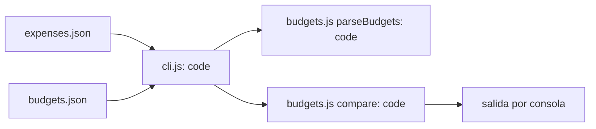

# Design: Presupuestos mensuales por categoría

Status: approved  |  Date: 2026-10-03  |  Requirements: requirements.md

## Overview
Se agrega un módulo puro `src/budgets.js` que valida los topes y compara el mes contra ellos
(R1.1, R1.2, R2.1, R2.2, R2.3). La CLI solo lee el archivo y formatea la salida (R1.1, R1.3).

## Architecture

Cada nodo es código determinista; no hay IA en esta funcionalidad.

## Workflow vs agent
Workflow: el camino es fijo y no requiere decisiones abiertas (R2.1).

## Data model / schema impact
Archivo nuevo `budgets.json`: `{ "comida": 600000, "transporte": 150000 }` (R1.1). Sin cambios al
formato de gastos. Ver docs/adr/0001-budgets-file-format.md.

## Interfaces and contracts
- `parseBudgets(obj) -> Map<string, number>`; lanza `Error` con el nombre de la categoría inválida (R1.2).
- `compare(byCategory, budgets) -> Array<{ category, spent, budget, diff, status }>`, con `status`
  en `ok | excedido | sin tope` (R2.1, R2.2, R2.3).
- CLI: `node src/cli.js <expenses.json> [YYYY-MM] [--budgets <file>]` (R1.1, R1.3).

## Error handling
Errores fatales: archivo inexistente (R1.3) o tope inválido (R1.2), código de salida 1, sin
reintentos (entrada local).

## Security considerations
Entrada externa: rutas de archivo y JSON del usuario. Se valida con `parseBudgets` (R1.2) y no se
evalúa código del archivo.

## Testing strategy
- Unit: `tests/budgets.test.js` para R1.1, R1.2, R2.1, R2.2, R2.3.
- Integration: `tests/cli.test.js` lanza la CLI con un archivo inexistente (R1.3).

## Alternatives considered
- Topes dentro del mismo archivo de gastos: descartado, mezcla datos con configuración (R1.1).

## Open questions
Ninguna.
