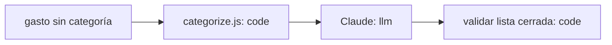

# Design: Categorización automática

Status: approved  |  Date: 2026-10-06  |  Requirements: requirements.md

## Overview
`src/categorize.js` recibe la descripción y devuelve una categoría de la lista cerrada (R1.1, R1.2).

## Architecture

## Workflow vs agent
Workflow: un solo paso con salida cerrada (R1.1).

## Data model / schema impact
Ninguno; se llena el campo `category` existente (R1.1).

## Interfaces and contracts
`suggestCategory(description) -> Promise<string>` (R1.1). Env: `ANTHROPIC_API_KEY` (R1.2).

## Error handling
Error de la API: devolver `otros`, sin reintentos (R1.3).

## Security considerations
La descripción es entrada externa enviada a un tercero; la clave vive en .env.local (R1.2).

## Testing strategy
- Unit: tests/categorize.test.js con el LLM simulado (R1.1, R1.3).
- Evals: dataset real y umbral 85% (R1.2).

## Alternatives considered
- Reglas por palabras clave: descartado, cubre menos del 60% de los casos reales (R1.2).

## Open questions
Ninguna.
