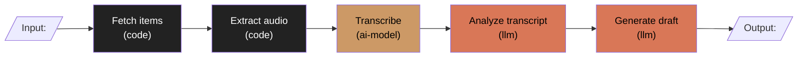

# Validation and system design (kickoff Step 2)

Write every user-facing line in the user's conversation language. The goal of this step is a
decision, not a document: should this be built, which approach, and what shape.

## 1. Problem on top

Write one sentence, in business terms, before any solution:

> "<Who> spends <time/money/effort> on <task> because <cause>; we want <measurable outcome>."

If the user cannot state the problem, ask once. If the answer is still a solution ("I want an
app that..."), ask what happens today without it and how much it costs.

## 2. Validation questions

Cover these in one AskUserQuestion batch where possible (skip what intake answered):

| Area | What you need |
|---|---|
| Users | Who uses it, how many, how often, and who pays |
| Why now | What changed (cost, volume, deadline, opportunity) |
| Current workaround | What they do today and what it costs |
| Success | One measurable signal for the first milestone |
| Alternatives | Existing tools, SaaS, spreadsheets, no-code, an n8n/Zapier flow, a script |

## 3. Go / no-go

State one of:

- **Go**: the problem is real, no off-the-shelf tool fits, the MVP is buildable within the
  constraints.
- **Go smaller**: real problem, but the proposed scope is too big. Name the smaller slice.
- **Buy / configure instead**: an existing tool covers 80%+. Name it and what it costs.
- **Don't build**: no clear user, no measurable pain, or the workaround is cheap enough.

Give 2 to 4 concrete reasons. Do not soften a no-go. If the user overrides, record the override
and the reason in the brief under Key decisions.

## 4. Two distinct approaches

Two approaches must differ in kind (for example: "custom web app" vs "automation over the tools
they already use"; "LLM extraction" vs "rules plus a form"), not in library choice. For each:

| | Approach A | Approach B |
|---|---|---|
| What it is | | |
| Time to first value | | |
| Running cost | | |
| Main risk | | |
| What it rules out later | | |

Recommend one, in one sentence, with the deciding reason.

## 5. Does this need AI?

Walk the process step by step. For each step ask: can deterministic code do it reliably? Use AI
only where it must interpret unstructured input or generate content. Prefer a specialized
non-generative model (speech-to-text, OCR, classifier, embeddings) over an LLM when one fits:
it is cheaper and more predictable. If no step needs AI, the project type does not include `ai`.

## 6. Workflow vs agent

- **Workflow**: the path between input and output is known in advance. Steps run in a fixed
  order (possibly with routing or parallel branches). Default choice.
- **Agent**: the model decides the path at runtime because the paths are too many or unknown.
  Choose it only when you can name the decisions the model must make and why they cannot be
  drawn in advance. List what could go wrong with autonomy (wrong path, skipped step, cost).

Rule of thumb: if you can draw a fixed flowchart, it is a workflow. Hybrid is fine: a workflow
with one agent step. Record the decision as an ADR.

## 7. Diagram template

Use Mermaid. Input and output as boxes, every node labeled with its kind. Keep it to the real
MVP, not the vision.

For non-AI projects, still draw the main user journey and data flow; mark all nodes `code`.

## 8. Project type

Pick any combination; write it into CLAUDE.md `Project type:`.

| Type | When | Gate it enables later |
|---|---|---|
| `web` | Has a UI users click through | E2E (Playwright) |
| `ai` | Any `llm` or `ai-model` node in the product | Evals with a dataset and threshold |
| `automation` | Scheduled or event-driven processing without a primary UI | Integration tests on real-shaped fixtures |
