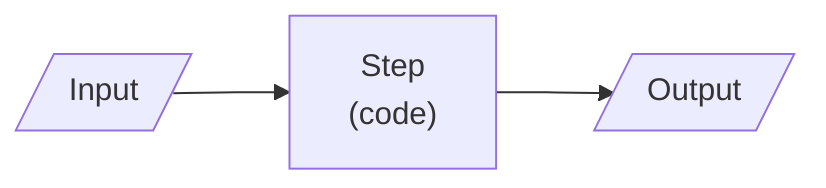

# <Project name>: brief

Status: <draft | approved>  |  Date: <YYYY-MM-DD>  |  Project type: <web, ai, automation>

## Problem
<One sentence in business terms: who spends what on which task, and the measurable outcome wanted.>

## Users
- <Primary user>: <who, how many, how often>
- <Secondary user, or remove>

## Why now
<What changed: cost, volume, deadline, opportunity.>

## Current workaround and its cost
<What they do today; time, money or errors it costs.>

## Alternatives considered
| Option | Why not (or why yes) |
|---|---|
| Don't build | <reason> |
| Buy / configure <tool> | <reason> |
| Approach A: <name> | <chosen or rejected, reason> |
| Approach B: <name> | <chosen or rejected, reason> |

## Recommendation
<Go | Go smaller | Buy instead | Don't build>, because <2 to 4 reasons>. <User override, if any, with reason.>

## System
- Input: <what enters>
- Processing: <main steps>
- Output: <what leaves, where it lands>
- Workflow or agent: <choice>, because <reason> (docs/adr/<NNNN>-workflow-vs-agent.md)

## Core journeys (MVP)
1. <Journey 1, end to end>
2. <Journey 2>

## First milestone
- Features in build order: <F1>, <F2>, <F3>
- Success signal: <one measurable signal>

## Non-functional requirements
- <Only those that shape the architecture, with the number: e.g. "p95 page load < 2 s for 50 users">

## Constraints
- Deadline: <date or none>
- Budget: <monthly ceiling>
- Team and maintenance: <who>
- Integrations and credentials: <systems, and whether access exists>

## Security and data
- Data stored: <list; mark personal / payment / credentials / uploads>
- Auth model: <none | single user | roles | multi-tenant>
- Secrets: <where they live>
- External input trusted: <list or none>

## Stack
| Layer | Choice | Version | Docs |
|---|---|---|---|
| <Language> | <...> | <x.y.z> | <link> |

Hosting: <target>

## Operation
- Tools: <Claude Code [, Cursor] [, Codex]>
- Autonomy: <auto | supervised>
- Paid services approved: <none | service (monthly cap)>
- Nightly cloud routine: <planned | not now> (docs/CLOUD.md in the Rockbuilt repo)

## Key decisions
- <Decision>, because <reason> (docs/adr/<NNNN-slug>.md)

## Out of scope
See docs/v2.md. Hard non-goals:
- <Non-goal>

## Open items
- ADVISORY: <item> (default: <value>)
- DEFERRED: <item> (to <spec or docs/v2.md>)
