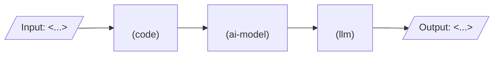

# Design: <feature name>

Status: draft  |  Date: <YYYY-MM-DD>  |  Requirements: ./requirements.md
ADRs: <docs/adr/NNNN-slug.md, ...>

Every item below cites the requirement IDs it serves. Anything without an R reference does not
belong here.

## Overview
<3 to 5 sentences: how the feature works end to end.> (R1, R2)

## Architecture

<!-- For AI systems, mark every node code, ai-model (non-generative) or llm. Each node maps to one implementation unit. -->

| Node / component | Kind | Responsibility | Location | Serves |
|---|---|---|---|---|
| <name> | code | <one line> | <src/path.ts> | R1.1, R1.2 |

## Workflow vs agent
<Workflow | Agent | Hybrid>, because <reason: is the path known in advance?>. Risks of the rejected
option: <list>. (ADR: docs/adr/NNNN-slug.md) (R..)

<Only for Agent or Hybrid; delete otherwise.>
- Instructions: <role, goal, what it must never do> (R..)
- Tools: <name, what it can change, approval needed: none | tool-level | agent-level> (R..)
- Memory: <none | per-run | across runs>, scoped by <user | tenant | thread>; never shared across
  users (R..)
- Stop condition and step budget: <when it stops, max steps or cost per run> (R..)
- Scorers: <what is graded against ground truth, in evals.md> (R..)

## UI
<Only for features with screens; delete otherwise.> Screens and states (empty, loading, error,
success), each with the criterion it serves (R..), and a link to the mockup or design file
(`.pen`, Figma, image). rb-e2e-writer uses this list to know which flows to cover.

## Data model / schema impact
- <Table/collection/file>: <new | changed fields>, migration: <name or none> (R..)
- Data retention and deletion: <rule> (R..)

## Interfaces and contracts
```ts
// Exact signatures, request/response shapes, events. (R..)
```
| Endpoint / function | Input | Output | Errors | Serves |
|---|---|---|---|---|

## Error handling
| Failure | Scope (per item / fatal) | Response | Retry (backoff, max) | Serves |
|---|---|---|---|---|
| <dependency down> | per item | <mark failed, continue> | <3 tries, exponential from 1 s> | R.. |

- Idempotency: <how a re-run avoids duplicates> (R..)
- Concurrency limit: <n, and why> (R..)
- Cleanup of temporary resources: <what, when> (R..)

## Security considerations
- Authn/authz on every data path: <where enforced, not only RLS> (R..)
- Input validation: <schema, where> (R..)
- Secrets: <env var names, never logged> (R..)
- Personal data: <what, retention> (R..)
- Agent memory and tools (Agent or Hybrid): no memory or tool result leaks across users or tenants (R..)
- New dependencies and their risk: <list or none>
- Security gate required: <yes/no, reason>

## Testing strategy
| Level | What | Covers |
|---|---|---|
| unit | <modules> | R1.1, R2.1 |
| integration | <real DB / recorded fixtures> | R1.2 |
| e2e | <flows; 1 happy path + 2 failure cases each> | R1.3 |
| evals | <dataset size, grader, threshold> | R2.2 |
| manual | <item and reason> | R2.3 |

## Risk and cost
Parts that will be tier C at build time (DESIGN.md section 6.1). Approving this design approves
the decisions; each plan is still escalated so the user can check it matches.

| Item | Why tier C | Cost estimate (monthly) | Serves |
|---|---|---|---|
| <new dependency / migration / auth change / infra / paid service> | <floor rule> | <USD n, or none> | R.. |

Paid services this feature needs: <none | service, cap; goes into AGENTS.md Paid services on approval>

## Alternatives considered
| Option | Why rejected |
|---|---|

## Open questions
- BLOCKING: <none, or question with recommended answer>
- ADVISORY: <question> (default: <value>)
